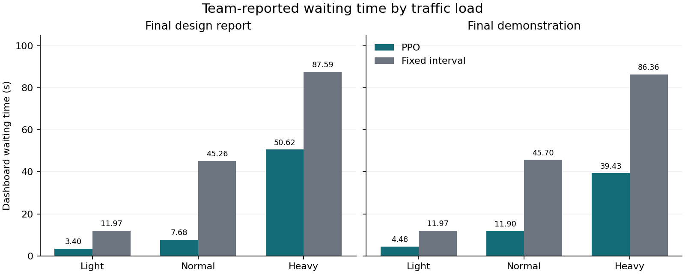

# Historical NTN results

These are **team-reported Ingolstadt21 simulation values** transcribed from two distinct capstone artifacts. Each table cell lists **RL / fixed-interval baseline** in that order. The dashboard values have two decimal places. The original JSON, seed-level records, and exact checkpoints for these comparisons were unavailable.

## Final design report

Source: `deliverables/documents/design_doc/v2/design_doc_g20_final.pdf`, PDF p. 13, Figure 8, “Results page.” Values checked against `deliverables/documents/design_doc/img/metrics_v2.png`, the figure's source image. Exact run configuration is unrecorded.

| Dashboard metric | Light | Normal | Heavy |
|---|---:|---:|---:|
| Reward | −46.97 / −181.22 | −112.68 / −323.73 | −636.98 / −959.08 |
| Waiting time (s) | 3.40 / 11.97 | 7.68 / 45.26 | 50.62 / 87.59 |
| Queue length (vehicles) | 0.73 / 1.77 | 1.78 / 4.68 | 6.00 / 8.17 |
| CO₂ emissions (dashboard g) | 1.57 / 1.62 | 1.96 / 1.98 | 2.09 / 2.11 |
| Average speed (km/h) | 12.28 / 9.26 | 14.28 / 8.17 | 12.54 / 5.84 |
| Fuel consumption (dashboard L/min) | 0.75 / 0.77 | 0.94 / 0.95 | 1.00 / 1.01 |
| Noise emission (dB) | 34.40 / 36.34 | 42.91 / 45.52 | 46.51 / 47.53 |

## Final demonstration

Source: `deliverables/demo_video/NTN_G20_FinalVideo.mp4`, dashboard around **03:04**. Setup around **02:01** shows train-and-test mode, three training episodes, seed 7, a 200 m observation distance, GUI enabled and libsumo disabled. The console shows newly saved model weights, GPU evaluation and test demand multipliers of 0.5×, 1×, and 3×. The recording does not establish the full submitted PPO or reward settings.

| Dashboard metric | Light | Normal | Heavy |
|---|---:|---:|---:|
| Reward | −52.68 / −181.22 | −147.45 / −283.60 | −460.48 / −944.15 |
| Waiting time (s) | 4.48 / 11.97 | 11.90 / 45.70 | 39.43 / 86.36 |
| Queue length (vehicles) | 1.10 / 1.77 | 2.74 / 4.65 | 5.86 / 8.19 |
| CO₂ emissions (dashboard g) | 1.52 / 1.62 | 1.99 / 1.99 | 2.16 / 2.10 |
| Average speed (km/h) | 10.50 / 9.26 | 11.75 / 8.31 | 10.51 / 5.88 |
| Fuel consumption (dashboard L/min) | 0.72 / 0.78 | 0.95 / 0.95 | 1.03 / 1.00 |
| Noise emission (dB) | 33.64 / 36.34 | 43.85 / 44.97 | 47.24 / 47.46 |
| Episode reward sum (console) | −3,161 / −10,873 | −8,847 / −17,016 | −27,629 / −56,649 |

The console sums come from the RL output at about **02:40–02:44** and baseline output at about **02:53**. The demo's heavy-traffic CO₂ and fuel summaries are higher for RL. Normal-traffic CO₂ and fuel tie at the dashboard's displayed precision.

## Definitions and interpretation

- **Aggregation.** Historical `src/utils/processing.py` averages signal summaries across signals and then simulation steps for the dashboard. Reward is summed across signals before the step average. Console reward sums over all steps. The reward combines tracked wait and queue penalties with local observation-entry and exit counts, followed by normalization and rounding. Reward has no physical unit.
- **Traffic metrics.** Wait is tracked vehicle wait summed per lane and averaged over lanes for each signal. Queue counts observed vehicles with positive tracked wait per signal. Speed uses mean nearby-vehicle speed and converts m/s to km/h. CO₂, fuel and noise average TraCI readings for active nearby vehicles at each signal. TraCI supplies CO₂ and fuel in mg/s. The historical code scales CO₂ by 0.001 and fuel by `0.025 * 60 / 1000`, and averages dB arithmetically. [TraCI vehicle API](https://sumo.dlr.de/daily/pydoc/traci/_vehicle.html) The displayed units above are preserved from the UI. Treat those rows as dashboard summaries. They do not establish total network emissions, fuel use, or physical sound exposure.
- **Evaluation design.** The final capstone code runs per-signal BiLSTM PPO training at 57,600–59,400 simulated seconds and tests the two controllers at 59,400–60,000, 60,000–60,600 and 60,600–61,200 with multipliers 0.5×, 1× and 3×. The control step is 10 s, including a 3 s yellow interval. These are code settings, with no run manifest tying them to every captured value. Scale changes with the time window. The comparison shows captured runs with no seed variance or independent generalization evidence.
- **Other artifacts.** The final poster's “Outcome” reports a preliminary **20% lower mean vehicle wait** against default configurations, without raw values or enough settings to match it to either table. The final team reflection (PDF p. 3, §2) reports qualitative comparisons. The final V&V report (PDF p. 8, §§5.2–5.3) describes the proposed split and metric definitions. Its percentages describe the test plan. An earlier design image contains illustrative hard-coded values verified against the old results template and is excluded from benchmark evidence.

## Waiting-time comparison

This figure redraws the six waiting-time pairs printed above. The original time-series plots remain separate.

## Independent verification

The synthetic-cross smoke run exercised the release's real SUMO controller loop, short PPO training, checkpoint reload and matched evaluation windows. A second smoke run exercised all 21 signals on pinned upstream RESCO v1.0 with the release lane discovery. Neither run replayed the historical experiment. No independent Ingolstadt21 performance values are reported. The historical time-series plots survive as embedded images in Figure 8 and around 03:08–03:13 of the demo. Republishing those images is pending permission. No values were inferred from plotted curves.
